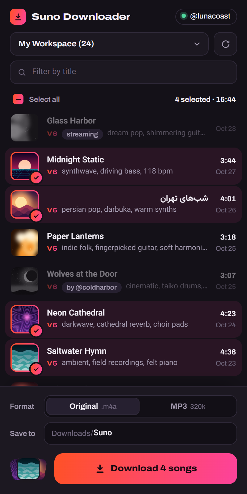
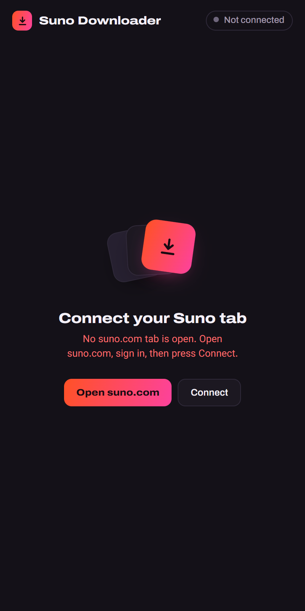
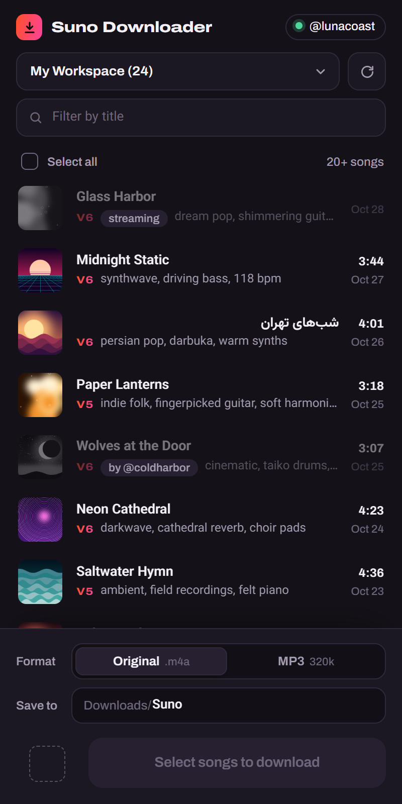
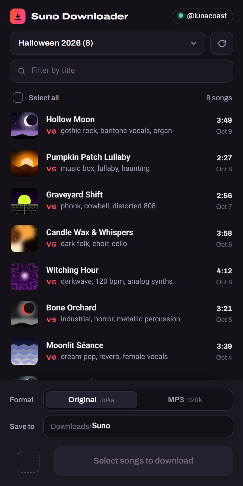
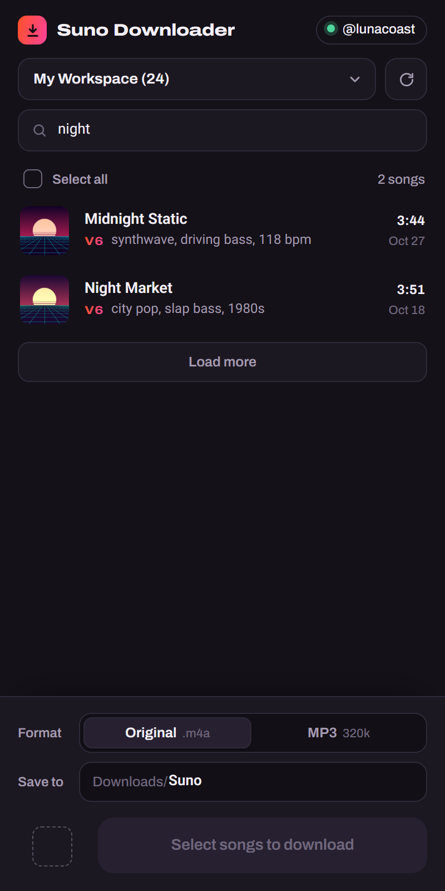
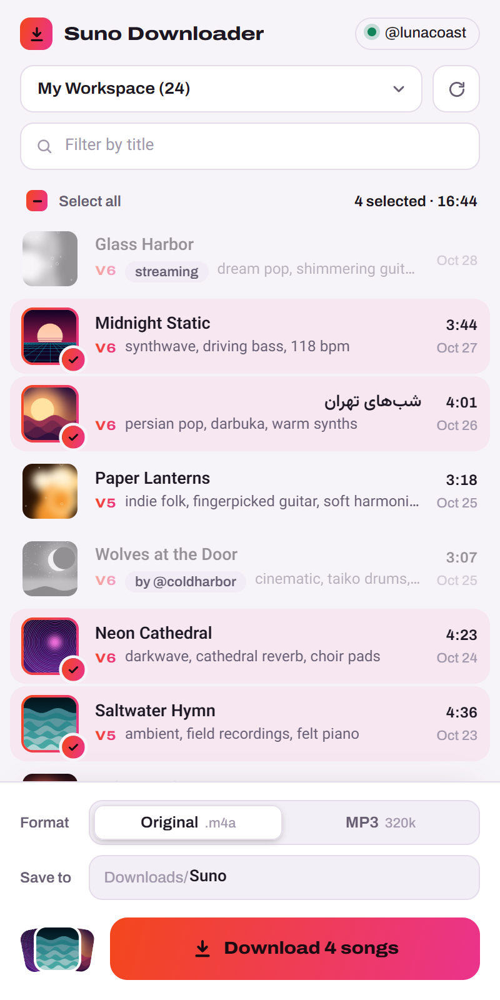
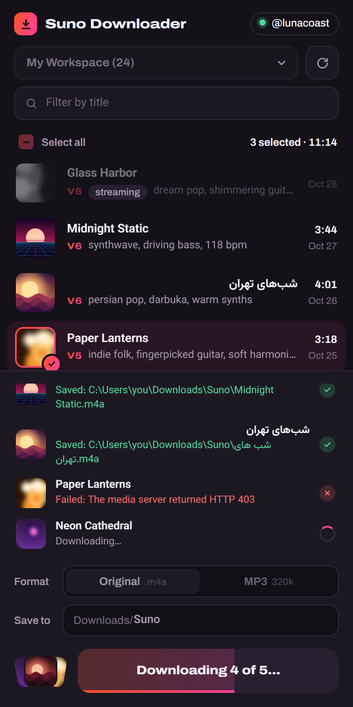
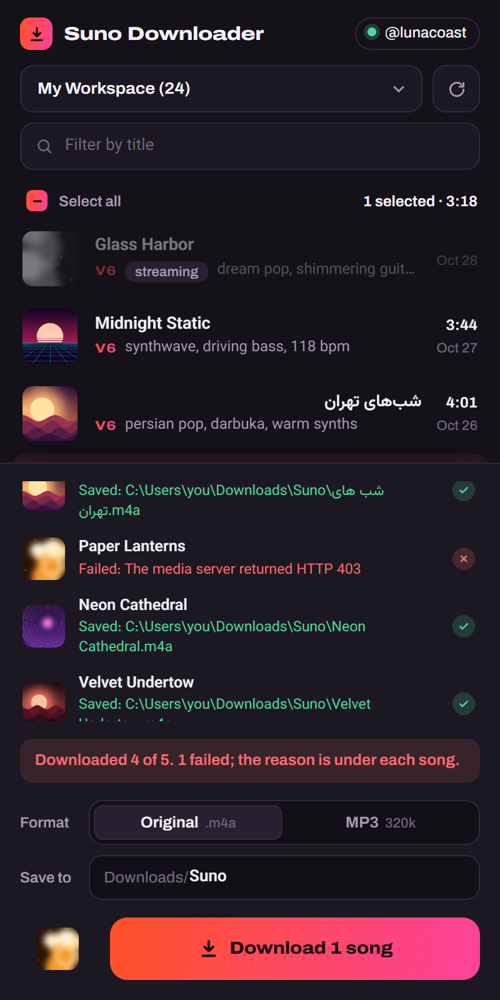
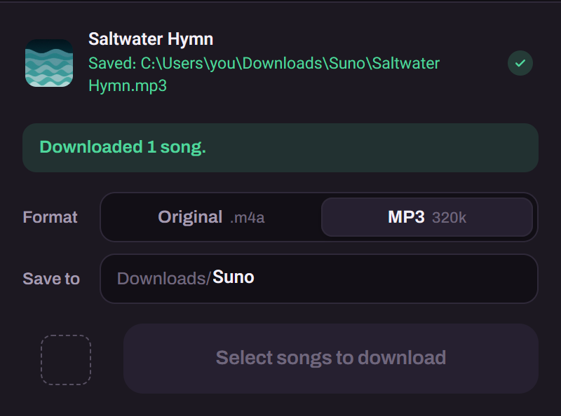

<div align="center">

# Suno Song Downloader

**Your own Suno songs as real audio files, from a Chrome side panel next to suno.com.**

It works through the suno.com tab you are already signed in to, so it stores no password and no token.
Each song is licensed, downloaded and decrypted the way Suno's own web player does it, then saved untouched or as a 320 kbps MP3.

[](LICENSE)


[Install](#install) · [The tour](#the-tour) · [Feature reference](#feature-reference) · [Permissions](#permissions-and-where-it-connects) · [Build from source](#building-from-source)

</div>

<p align="center"></p>

<div align="center"><em>Every screenshot here is the real extension, running against a stand-in suno.com loaded with demonstration songs.</em></div>

## Install

1. Download **`suno-song-downloader.zip`** from the [latest release](https://github.com/DrSaeedHub/Suno-Song-Downloader/releases/latest) and unzip it into a folder you will keep.
2. Open `chrome://extensions`, turn on **Developer mode**, click **Load unpacked** and pick that folder.
3. Open [suno.com](https://suno.com), sign in, and click the extension's icon. Chrome puts new icons under the puzzle-piece menu; pin it there to keep it in the toolbar.

The panel opens in Chrome's side panel and connects to the suno.com tab on its own. It needs Chrome 116 or later.

<details>
<summary><strong>Updating, settings and removing it</strong></summary>

To update, unzip a newer release over the same folder and press the reload arrow on the extension's card in
`chrome://extensions`. Chrome derives an unpacked extension's id from its folder's path, so the same folder keeps the
same extension, and with it your saved format, folder and workspace. Unzipped somewhere else, it is a new extension
with default settings. Unpacked extensions are not updated by Chrome, so a new release is always this manual step.

To remove it, press **Remove** on its card. The files it saved stay in your Downloads folder.

</details>

---

# The tour

## It works through the suno.com tab you are signed in to

The panel never asks you to sign in. When it needs Suno, it injects one function into your suno.com tab with
`chrome.scripting.executeScript` and makes the request there: from suno.com's own origin, with that tab's cookies,
through the same `/a` proxy the web app uses. The session is the tab's `__session` cookie. A token within 60 seconds
of expiring is refreshed through Suno's sign-in service first, and a `401` is retried once with a fresh token.

| No suno.com tab open | Connected |
|---|---|
|  |  |

**Open suno.com** opens one, and the panel connects by itself as soon as a suno.com tab finishes loading. Before every
download it reads the tab's session again. If the tab has been switched to another account, it reloads the list for
that account instead of downloading under the old one.

## Your workspaces, with the filters Suno's Create page uses

Workspaces come from your projects, with their song counts, and the panel remembers the last one you picked. A
workspace's list asks Suno's feed for what the Create page shows: no disliked or trashed songs, no stems, nothing from
Studio projects. Each row has the cover, the title (Persian and other right-to-left titles read right to left), the
model version, the style tags, the length and the date. Songs load twenty at a time, with **Load more** for the rest,
and the filter narrows the loaded songs by title.

| Another workspace | Filtered by title |
|---|---|
|  |  |

## Only your own, finished songs can be picked

A song by another account, one still generating, or one without a downloadable file stays in the list, greyed out,
with the reason beside its tags: `by @coldharbor`, `streaming`. Picking a song rings its cover. The covers of the last
three you picked pile up beside the Download button, and the line above the list keeps the count and the total
length. **Select all** takes every song the filter shows that can be downloaded.

<p align="center"></p>

The panel follows the system's light or dark setting; this is the light theme.

## Downloads you can watch, and failures that say why

Songs download one at a time, in list order, each through the steps Suno's player takes: a license from
`/api/mango/rights`, the encrypted file, decryption, then the save. Each song's line names the step it is on, with a
progress bar while the file arrives, and the Download button fills as songs finish. **A song that fails says why, and
the rest carry on.** Songs that saved are unticked, so whatever is still ticked is what did not make it.

| Downloading | Finished, with one failure |
|---|---|
|  |  |

<details>
<summary><strong>What happens to each song</strong></summary>

- **License.** The content key and the IV come wrapped in AES-256-GCM under SHA-256 of the access token (or of the
  license's own short-lived token), with the song's id as additional data. A wrong key fails authentication instead of
  producing noise.
- **Download.** The file is fetched over HTTPS only, without cookies. A response that is an HTML, JSON or text page, an
  empty file, or one shorter than its `Content-Length` is rejected.
- **Decryption.** AES-128-CTR, in the panel, with Web Crypto.
- **Format.** The decrypted file's first bytes decide its extension: MP4 is saved as `.m4a`, WebM as `.webm`, and
  anything else as `.bin` with a warning on the line.
- **Save.** `chrome.downloads` writes the file without a save dialog. The line says **Saved** only after Chrome reports
  the download complete, and shows the path Chrome actually used.

</details>

## The file Suno serves, or an MP3

**Original** saves the decrypted file byte for byte, with no re-encoding. **MP3** has Chrome decode the audio at
48 kHz and LAME encode it at 320 kbps in a worker, so the panel stays responsive, and writes the title into an ID3 tag
in UTF-16 so Persian titles survive. Files go into a folder inside Downloads, `Suno` unless you change it.

<p align="center"></p>

File names are the titles, cleaned of what Windows and Chrome's downloads API refuse. Characters Windows forbids and
`~` are removed, along with invisible control and format characters; a Persian zero-width non-joiner becomes a space, as in `شب های تهران.m4a`
above. Names are cut at 120 characters, and Windows device names such as `CON` get an underscore. Two songs with the
same title in one batch get the first eight characters of their id appended, and an existing file is never
overwritten: Chrome adds a number instead.

---

# Feature reference

| | |
|---|---|
| **Connection** | Works through the signed-in suno.com tab, with no stored credentials · the active suno.com tab first, else any open one · token refresh within 60 s of expiry and one retry on `401` · Suno's `/a` proxy, with `studio-api.prod.suno.com` as the fallback · connects by itself when a suno.com tab finishes loading · **Open suno.com** and **Connect** buttons · the account's handle in the header · re-checks the account before every download |
| **Workspaces** | Every project, with song counts · My Workspace always present · the last one picked is remembered · the same feed filters as the Create page: no disliked, trashed, stem or Studio-project songs |
| **The list** | Cover art, title, model version, style tags, length and date · right-to-left titles · twenty songs a page with **Load more** · filter by title over the loaded songs · placeholder rows while the first page loads · messages for an empty workspace and for a filter that matches nothing |
| **Picking** | Only the account's own songs that are complete and have a downloadable file · the reason shown on the others · **Select all** over the filtered songs · count and total length · the last three covers piled beside the Download button |
| **Downloading** | One song at a time · license, encrypted file, AES-128-CTR decryption, save · per-song step and progress · the Download button fills as songs finish · a failure names its cause and the batch carries on · saved songs are unticked · a summary of saved and failed |
| **Integrity** | HTTPS-only media, fetched without cookies · rejects HTML, JSON and text responses, empty files and short reads · GCM-authenticated key unwrapping · format from the file's own bytes |
| **Output** | Original file byte for byte (`.m4a` or `.webm`) or MP3 at 320 kbps with an ID3 title · a folder inside Downloads, `Suno` by default · no save dialog · names cleaned of what Windows and Chrome refuse, cut at 120 characters · same-title songs in a batch get an id suffix · existing files never overwritten |
| **Interface** | Chrome's side panel, opened from the toolbar icon · dark and light from the system theme · Archivo and Vazirmatn bundled, so Persian renders the same everywhere · visible keyboard focus · reduced motion respected · fits Chrome's narrowest side panel, 320 px |
| **Distribution** | No build step · a release zip built by GitHub Actions on every push · prereleases from branches other than the default |

---

## Permissions, and where it connects

| Permission | What it is for |
|---|---|
| `sidePanel` | The panel itself; the toolbar icon opens it |
| `scripting` | Running the request function inside your suno.com tab |
| `downloads` | Saving the files into Downloads |
| `storage` | Remembering the format, the folder and the workspace |
| `https://suno.com/*`, `https://*.suno.com/*` | The tab it works through, and Suno's API and sign-in service |
| `https://*.suno.ai/*`, `https://*.cloudfront.net/*` | Cover art and the audio files |

The panel talks to Suno and nobody else: no analytics and no update checks. Its fonts and the LAME encoder ship inside
the extension rather than loading from the web.

## Settings it keeps

Three values, in `chrome.storage.local`. If storage cannot be read, the defaults apply.

| Setting | Default | Meaning |
|---|---|---|
| Format | Original | `original` or `mp3` |
| Folder inside Downloads | `Suno` | Each part is cleaned like a file name; `.` and `..` are dropped |
| Workspace | My Workspace | The workspace listed when the panel opens |

## Releases

Every push to any branch runs `.github/workflows/release.yml`. It builds `suno-song-downloader.zip` with `git archive`
(root dotfiles left out, `manifest.json` checked to be at the root) and publishes it as the release
`v<version>-build.<run number>`, the version being `manifest.json`'s. Pushes to a branch other than the default one
become prereleases, so **latest** is always a build of the default branch.

## Building from source

There is no build step: the repository is the extension. Clone it, then **Load unpacked** the repository folder in
`chrome://extensions`. After a change, press the reload arrow on the extension's card and reopen the panel.

Bundled third-party code: `vendor/lame.min.js` (lamejs, the LAME MP3 encoder in JavaScript) and the Archivo and
Vazirmatn variable fonts in `fonts/`.

### Screenshots

Every image in this README comes from one command:

```bash
python tools/demo/demo.py                  # retake every screenshot into docs/screenshots
python tools/demo/demo.py --only <names>   # only these shots, comma-separated
python tools/demo/demo.py serve            # look around in a visible Chromium
python tools/demo/demo.py reset            # forget the demo's state in .demo/
```

It needs Python 3.9 or later with Playwright, Pillow and `cryptography`
(`pip install playwright pillow cryptography`, then `python -m playwright install chromium`), and ffmpeg on `PATH`.

The demo loads a copy of the working tree into Playwright's Chromium and opens the side panel as a tab;
`tools/demo/shots.json` is the shot list. suno.com is replaced by a stand-in answered from inside the browser
(`tools/demo/suno.py`): 37 songs in four workspaces with generated cover art, and a short Opus file encrypted per song
the way Suno serves it. Downloads therefore really license, decrypt and save, into `.demo/Downloads`. One song's link
answers `403`, to show a failure. Every other HTTPS request is aborted, so a run never reaches Suno. The one thing
changed in the extension's view is the saved path, which shows `C:\Users\you\Downloads` in place of the demo's folder.

## Layout

```
manifest.json        MV3 manifest: permissions, side panel, icons
background.js        makes the toolbar icon open the side panel
sidepanel.html       the panel
sidepanel.css        its styles, dark and light from the system theme
sidepanel.js         connection, the list, picking, the download pipeline, file names
suno-tab.js          the function run inside the suno.com tab: session, token refresh, API calls
crypto.js            license unwrapping (AES-GCM), decryption (AES-CTR), format sniffing
audio.js             MP3: decoding, the encoder worker, the ID3 title tag
mp3-worker.js        LAME encoding off the panel's thread
vendor/              lamejs and its license
fonts/               Archivo and Vazirmatn, with their licenses
icons/               toolbar and extension icons
tools/demo/          the screenshot demo: stand-in suno.com, demonstration library, shot list
docs/screenshots/    the images in this README
.github/workflows/   the release build
```

## License

[GPL-3.0](LICENSE). The bundled lamejs is under the LGPL ([its notice](vendor/lamejs-LICENSE.txt)), and the Archivo
and Vazirmatn fonts under the SIL Open Font License 1.1 ([Archivo](fonts/archivo-LICENSE.txt),
[Vazirmatn](fonts/vazirmatn-LICENSE.txt)).

This project is not affiliated with or endorsed by Suno.
